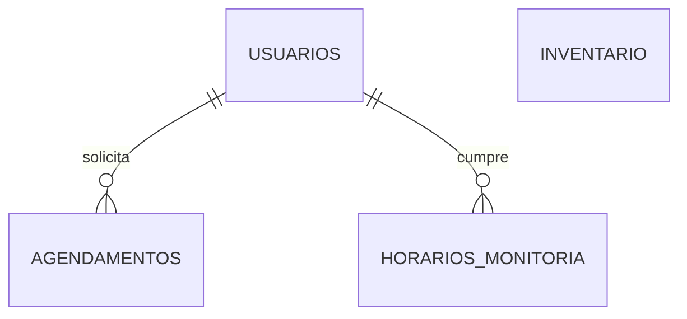

# IFMAKER & LAB 4.0 - IFAL Campus Marechal Deodoro

Sistema web para gerir o laboratório maker do IFAL - Campus Marechal Deodoro. Centraliza o inventário de componentes e ferramentas, a escala de monitoria e o fluxo de agendamento de equipamentos (impressora 3D, cortadora laser, bancada de eletrônica e outros).

Alunos pedem horários. Monitores aprovam ou recusam. Ao aprovar, o sistema cria um card no Trello.

## Sumário

- [Funcionalidades](#funcionalidades)
- [Perfis de acesso](#perfis-de-acesso)
- [Estado atual do projeto](#estado-atual-do-projeto)
- [Tecnologias](#tecnologias)
- [Estrutura do projeto](#estrutura-do-projeto)
- [Banco de dados](#banco-de-dados)
- [Rotas](#rotas)

## Funcionalidades

### Acesso

- Login unificado em uma só tela, com dois modos:
  - **Aluno:** matrícula e senha.
  - **Monitor, coordenador ou admin:** username e senha.
- Cadastro de aluno com nome, e-mail, matrícula e senha.
- Senhas com hash (Werkzeug). Nunca ficam em texto limpo no banco.
- Sessão com Flask-Login.

### Agendamento

- Escolha do equipamento entre as categorias cadastradas.
- Horários fixos: 08:00, 09:30, 13:00 e 14:30.
- Campo de projeto ou disciplina vinculada e descrição.
- Para a categoria "Outros", a descrição é obrigatória.
- Bloqueio de colisão: não aceita pedido para um equipamento, data e horário que já têm uma reserva aprovada.
- Envio sem recarregar a página (`Fetch API`).

### Moderação (monitores)

- Lista de todos os agendamentos, do mais recente para o mais antigo.
- Aprovar ou recusar com um clique, sem recarregar a página.
- Ao aprovar, cria um card no Trello com aluno, equipamento, data, horário, projeto e descrição. Se o Trello falhar, a aprovação continua valendo.

### Inventário

- Consulta pública de componentes e ferramentas, com busca por nome e filtro por categoria.
- Monitores adicionam, editam, salvam em lote e removem itens.
- Cada item tem nome, descrição, categoria, quantidade e status (`ok`, `busy`, `unavail`).

### Monitoria

- Escala semanal por dia e turno.
- Voluntários aparecem em azul e bolsistas em verde.
- Cadastro de monitores, coordenadores e admins pela interface.
- Remoção de membros (coordenador e admin).
- Apagar todos os agendamentos de uma vez (coordenador e admin).

### Painel inicial

- Total de equipamentos (soma das quantidades do inventário).
- Total de monitores.
- Total de agendamentos.

### Outros

- Página de erro própria para falhas 500, com rollback da sessão do banco.
- Rotas `/ping` e `/cron` para verificação de disponibilidade.

## Perfis de acesso

| Perfil (`role`) | O que faz |
|---|---|
| `aluno` | Agenda equipamentos |
| `monitor` | Modera agendamentos, gerencia inventário, cadastra monitores |
| `coordenador` | Tudo do monitor, mais remover membros e apagar todos os agendamentos |
| `admin` | Mesmos poderes do coordenador |

Monitor voluntário não é um perfil. É um `monitor` com `is_voluntario = True`.

## Estado atual do projeto

| Recurso | Situação |
|---|---|
| Login, cadastro e logout | Pronto |
| Agendamento de equipamentos | Pronto |
| Aprovação e recusa de agendamentos | Pronto |
| Integração com Trello | Pronto |
| Inventário (consulta e edição) | Pronto |
| Cadastro e remoção de monitores | Pronto |
| Escala de monitoria (exibição) | Pronto |
| Edição da escala pela interface | Não implementado. Os horários são inseridos direto no banco |
| Recuperação de senha | Não implementado |

## Tecnologias

- Python 3
- Flask 3.1
- Flask-SQLAlchemy 3.1 / SQLAlchemy 2.0
- Flask-Login 0.6
- Werkzeug (hash de senhas)
- python-dotenv
- requests (API do Trello)
- PostgreSQL (`psycopg2-binary`), com Neon como provedor
- Gunicorn
- Jinja2
- HTML, CSS e JavaScript puro, em um único template
- Google Fonts

## Estrutura do projeto

```text
IFMAKER-4.0/
├── app.py               # Configuração, modelos, rotas e comando CLI
├── requirements.txt
├── templates/
│   ├── index.html       # Página única, com seções alternadas por JavaScript
│   └── erro.html        # Página de erro 500
├── .env                 # Não versionado
└── .gitignore
```

### Seções do `index.html`

| `id` | Conteúdo |
|---|---|
| `home` | Apresentação e números do laboratório |
| `monitoria` | Escala semanal e lista de monitores |
| `agendamento` | Formulário de agendamento |
| `inventario` | Inventário com busca e filtro |
| `acesso` | Login e cadastro. Para quem está logado, mostra o painel do aluno ou do monitor |

A troca de seção é feita por `showSection(id)`, sem recarregar a página.

## Banco de dados



`inventario` não tem relação com as outras tabelas. O campo `agendamentos.equipamento` guarda o slug da categoria, não uma chave estrangeira.

### usuarios

| Campo | Tipo | Observações |
|---|---|---|
| id | Integer | PK |
| nome | String(100) | Obrigatório |
| email | String(100) | Único, obrigatório |
| password_hash | String(200) | Hash Werkzeug |
| matricula | String(20) | Único. Usada pelos alunos |
| username | String(50) | Único. Usado por monitores, coordenadores e admins |
| role | String(20) | `aluno` (padrão), `monitor`, `coordenador` ou `admin` |
| is_voluntario | Boolean | `False` por padrão |

### horarios_monitoria

| Campo | Tipo | Observações |
|---|---|---|
| id | Integer | PK |
| dia_semana | String(20) | Ex.: `Segunda`, `Terça` |
| turno | String(10) | Ex.: `Manhã`, `Tarde` |
| monitor_id | Integer | FK para `usuarios.id` |

### inventario

| Campo | Tipo | Observações |
|---|---|---|
| id | Integer | PK |
| nome | String(100) | Obrigatório |
| descricao | Text | |
| categoria | String(30) | Slug da categoria (veja abaixo) |
| quantidade | Integer | `0` por padrão |
| status | String(20) | `ok` (padrão), `busy` ou `unavail` |

### agendamentos

| Campo | Tipo | Observações |
|---|---|---|
| id | Integer | PK |
| equipamento | String(50) | Slug da categoria |
| data_reserva | String(10) | Formato `YYYY-MM-DD` |
| horario_slot | String(10) | Ex.: `08:00` |
| projeto_vinculo | String(100) | Projeto ou disciplina |
| descricao | Text | |
| status | String(20) | `Pendente` (padrão), `Aprovado` ou `Recusado` |
| usuario_id | Integer | FK para `usuarios.id`, com `ON DELETE CASCADE` |

Apagar um usuário apaga os agendamentos e os horários dele.

### Categorias de equipamento

Definidas em `CATEGORIAS_EQUIPAMENTO`, no `app.py`. Ficam disponíveis em todos os templates.

| Slug | Nome |
|---|---|
| `3d` | Impressora 3D |
| `laser` | Cortadora Laser |
| `arduino` | Bancada Eletrônica |
| `lego` | Kit Educacional Lego |
| `ferramentas` | Ferramentas |
| `outros` | Outros |

> Não altere os slugs sem migrar os dados do banco. Eles são usados em `inventario.categoria` e `agendamentos.equipamento`.

## Rotas

### Públicas

| Rota | Método | Descrição |
|---|---|---|
| `/` | GET | Página principal |
| `/login` | POST | Autentica aluno ou monitor |
| `/registrar_aluno` | POST | Cadastra aluno |
| `/ping` | GET | Verificação de disponibilidade |
| `/cron` | GET | Verificação de disponibilidade |

### Usuários logados

| Rota | Método | Descrição |
|---|---|---|
| `/logout` | GET | Encerra a sessão |
| `/api/agendar` | POST | Cria um pedido de agendamento (JSON) |

### Monitores, coordenadores e admins

| Rota | Método | Descrição |
|---|---|---|
| `/api/agendamento/<id>/status` | POST | Aprova ou recusa (JSON). Aprovar cria o card no Trello |
| `/inventario/adicionar` | POST | Adiciona item |
| `/inventario/editar/<item_id>` | POST | Edita item |
| `/salvar_inventario_em_lote` | POST | Salva vários itens de uma vez |
| `/remover_inventario/<item_id>` | POST | Remove item |
| `/monitor/adicionar` | POST | Cadastra monitor, coordenador ou admin |

### Coordenadores e admins

| Rota | Método | Descrição |
|---|---|---|
| `/monitor/remover/<monitor_id>` | POST | Remove um membro. Não permite remover a si mesmo |
| `/agendamentos/apagar-todos` | POST | Apaga todos os agendamentos |
